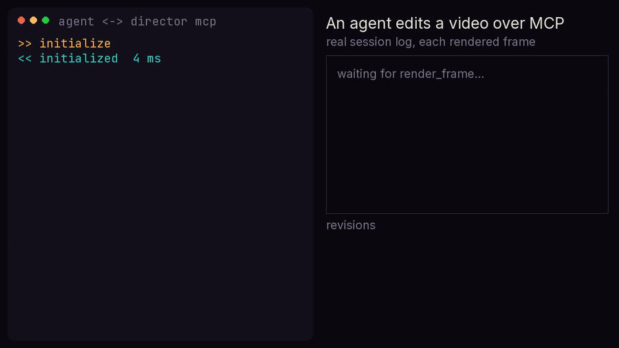
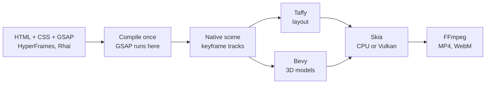

<div align="center">


# Director

**Write a video in HTML and CSS. Render it without a browser.**

Director compiles your composition, GSAP timelines included, into a native scene,<br>
then paints every frame with Skia on the CPU or on Vulkan. It's written in Rust.

[](https://crates.io/crates/director-cli)
[](#license)
[](#built-for-agents)
[](https://www.rust-lang.org)

[Quick start](#quick-start) · [Why Director](#why-director) · [Agents](#built-for-agents) · [Features](#what-it-renders) · [Examples](#examples) · [Library](#use-it-as-a-library) · [Roadmap](#roadmap)

</div>

https://github.com/user-attachments/assets/98d02b48-bc6d-4e67-9da9-dfa26e9ea516

<p align="center"><sub>One HTML file, rendered by Director with 16-sample motion blur and a depth-sorted 3D globe.</sub></p>

<br>

## Why Director

Most HTML-to-video tools open a headless browser and screenshot it once per frame. Director reads your HTML and CSS once, runs GSAP at compile time, and turns the whole thing into native keyframe tracks. Taffy does layout, Skia paints and FFmpeg encodes.

**About 4x faster than HyperFrames.** Same 120-second 1080p30 clip, source to finished MP4 with audio:

| | Director | HyperFrames 0.7.48 | |
|---|---:|---:|---|
| CPU, software x264 | **30.4 s** | 118.2 s | 3.9x faster |
| GPU, NVENC | **21.1 s** | 100.0 s | 4.7x faster |

<sub>Measured 2026-11-06 on a Ryzen 9 9900X with an RTX 5060 Ti. In the same sitting raea 0.1.0-canary.2, a native Bevy renderer, did a TSX port of the clip in 23.6 s against Director's 19.1 s. The clip is in <a href="examples/html/benchmark/">examples/html/benchmark</a> and every command is in <a href="docs/plans/10-native-platform-overhaul.md#latest-measurements">plan 10</a>, so you can rerun it.</sub>

**Same input, same frames.** There's no browser version to pin and no page load to race, so a render repeats exactly. The test suite checks renders against golden frames.

**An agent can drive it end to end.** The CLI reports layout, timing, contrast, safe zones and loudness as JSON, and `director-engine mcp` hands a model a live editing session. More [below](#built-for-agents).

| | Director | Browser-based renderers |
|---|---|---|
| What draws each frame | Native engine (Taffy, Skia, FFmpeg) | Headless Chrome |
| Browser at render time | None | Required |
| Authoring | HTML, CSS and GSAP, or Rhai scripts | Depends on the tool (React for Remotion) |
| Real 3D | glTF, Gaussian splats, particles and physics on Bevy | WebGL inside the page |
| Agent tooling | JSON checks, MCP server, editor protocol | Varies |

## Quick start

You need Rust, Clang and FFmpeg ([setup per OS](#building-from-source)). Then:

```bash
cargo install director-cli
```

That installs `director-engine`. The first build compiles Skia and Bevy, so give it a few minutes.

Save this as `hello.html`:

```html
<div data-composition-id="hello" data-width="1920" data-height="1080" data-fps="30" data-duration="3"
     style="display:flex; align-items:center; justify-content:center; background:#101820">
  <h1 class="title">Hello, Director</h1>
</div>
<style>
  .title { color: white; font: 700 120px sans-serif; animation: rise 1s ease-out both; }
  @keyframes rise { from { opacity: 0; transform: translateY(80px); } to { opacity: 1; transform: none; } }
</style>
```

And render it:

```bash
director-engine html render hello.html -o hello.mp4

# Paint on Vulkan and encode on an NVIDIA card (each flag works on its own)
director-engine html render hello.html -o hello.mp4 --gpu --encoder nvenc

# Grab a single frame
director-engine html still hello.html -t 1.5 -o frame.png
```

The root element sets canvas size, frame rate and duration. Everything inside is ordinary HTML and CSS.

> [!TIP]
> Using GSAP? Director runs it at compile time, so the page needs a local copy. Run `npm install gsap` in the page's folder or any parent, or point `DIRECTOR_GSAP_DIR` at a `gsap/dist` folder.

## Built for agents

<p align="center">
  
</p>
<p align="center"><sub>A real MCP session. The model opens a scene, patches it four times and renders after each revision. Each patch takes about 10 ms; each 1080p frame about 160 ms.</sub></p>

Give Claude Code, Cursor or any MCP client a Director session:

```bash
claude mcp add director -- director-engine mcp
```

```json
{ "mcpServers": { "director": { "command": "director-engine", "args": ["mcp"] } } }
```

The server opens any input, patches nodes against a revision, renders frames, diffs sessions, runs QA and exports. Add `--gpu` to paint on Vulkan and `--allow-dir <DIR>` to let it write outside the project folder.

The same checks run from the CLI, so an agent can review a video without watching it:

| Command | What it reports |
|---|---|
| `inspect`, `outline` | Layout, timeline and audio as JSON, plus the node tree |
| `check`, `qa` | Off-canvas elements, missing fonts, safe zones, text contrast and reading time, caption cues, the audio mix, encoder blotching. `qa` on a bare MP4 checks static stretches and loudness |
| `sheet`, `onion`, `still` | Contact sheets, blended motion trails and single frames |
| `snapshot`, `diff` | A frame against a golden PNG, two scene documents against each other |
| `audio` | Loudness, clipping and silence |
| `editor` | A JSON-line editing protocol with frames in shared memory, for building UIs on top |

## What it renders

<table>
<tr><td width="50%" valign="top">

**Layout**<br>
Flexbox, grid with `subgrid` and named lines, absolute, fixed and sticky positioning, `calc()`.

</td><td width="50%" valign="top">

**Text**<br>
Rich inline spans and boxes, strokes, shadows, variable font axes, SplitText and rolling digit reels.

</td></tr>
<tr><td valign="top">

**Paint**<br>
Gradients, masks, clip paths, filters, blend modes, SVG, and 3D transforms with `preserve-3d` depth sorting. `.cube` LUT grades with animatable crossfades.

</td><td valign="top">

**Animation**<br>
CSS keyframes and transitions, SVG SMIL, beat grids from music, and GSAP with MotionPath, MorphSVG, DrawSVG and SplitText. All of it compiles to native tracks.

</td></tr>
<tr><td valign="top">

**Motion blur**<br>
Each frame samples its shutter. A frame that holds still paints once, and fast motion gets more samples.

</td><td valign="top">

**Media**<br>
Images, video, multi-track audio and Lottie. Word-timed transcripts and subtitles with the optional `asr` feature.

</td></tr>
<tr><td valign="top">

**Real 3D**<br>
glTF scenes, Gaussian splats, extruded type, particles and rigid-body physics, rendered by Bevy on Vulkan and placed with an HTML `<model>` element. Includes a path-traced quality level and camera solving from footage for matchmoves.

</td><td valign="top">

**Export**<br>
x264 or NVENC MP4, VP9 with alpha, draft encodes and reduced-scale renders. HyperFrames compositions compile natively, and Rhai scripts can generate scenes too.

</td></tr>
</table>

## Examples

| Example | What it shows |
|---|---|
| [`showreel.html`](examples/html/showreel.html) | The reel at the top of this page, in one file |
| [`gsap-motion.html`](examples/html/gsap-motion.html) | GSAP timelines compiled to native tracks |
| [`motion-path.html`](examples/html/motion-path.html) | GSAP MotionPath |
| [`split-text.html`](examples/html/split-text.html) | SplitText animation |
| [`kinetic-beats.html`](examples/html/kinetic-beats.html) | Cuts on a beat grid from music |
| [`colour-grades.html`](examples/html/colour-grades.html) | LUT colour grades |
| [`particles.html`](examples/html/particles.html) | 3D particles: embers and dust |
| [`physics.html`](examples/html/physics.html) | Baked rigid-body physics |
| [`film/`](examples/html/film/) | A multi-shot film with 3D models |
| [`benchmark/`](examples/html/benchmark/) | The benchmark clip above |
| [`mcp-demo/`](examples/mcp-demo/) | The agent session in the GIF above, with its full log |
| [Rhai examples](examples/README.md) | Scenes built from scripts: layout, text, effects, transitions, captions |

## Use it as a library

`director-host` opens any input as a session you can patch, inspect, render and export:

```toml
[dependencies]
director-host = "0.1"
```

```rust
use director_host::{ExportSettings, NodeSelector, PatchOp, Session, Source};
use serde_json::json;

fn main() -> Result<(), Box<dyn std::error::Error>> {
    let mut session = Session::open(&Source::new("examples/html/native-motion.html".into()))?;
    let hide = PatchOp::Set { node: NodeSelector::Name("pulse".into()), path: "/body/hidden".into(), value: json!(true) };
    session.patch(session.revision(), &[hide])?;
    session.export("native.mp4".as_ref(), &ExportSettings::default(), None)?;
    Ok(())
}
```

## How it works



Page scripts run once, in a helper process, while the page compiles. The renderer itself links no JavaScript engine. [docs/architecture](docs/architecture/overview.md) covers the internals.

## Building from source

| Dependency | Ubuntu | macOS | Windows |
|---|---|---|---|
| FFmpeg | `apt install libavutil-dev libavformat-dev libavcodec-dev libswscale-dev` | `brew install ffmpeg` | [gyan.dev shared build](https://www.gyan.dev/ffmpeg/builds/), with `FFMPEG_DIR` set |
| Clang (for Skia) | `apt install clang` | Xcode | LLVM |

```bash
git clone https://github.com/stepupgaming/director.git
cd director
cargo build --release -p director-cli --bin director-engine
target/release/director-engine html render examples/html/native-motion.html -o native.mp4
```

Always build with `--release`. Skia downloads as a prebuilt library. [docs/contributing/development.md](docs/contributing/development.md) has the full setup.

<details>
<summary><b>Repository layout</b></summary>

| Path | Contents |
|---|---|
| `crates/director-html` | HTML, CSS, HyperFrames and GSAP compiler |
| `crates/director-core` | Scene graph, layout, animation, text, media and the Rhai API (published as `director-video-core`) |
| `crates/director-scene` | Serializable scene document |
| `crates/director-render` | Frame rendering, motion blur and export |
| `crates/director-host` | Session API: open, patch, inspect, render, export |
| `crates/director-3d` | glTF scenes, splats, particles and physics on Bevy, authored as `<model>` |
| `crates/director-track` | Feature tracking and camera solving from footage |
| `crates/director-asr` | Speech to text and subtitles |
| `crates/director-breakdown` | Shot breakdown of a reference video |
| `crates/director-cli` | The `director-engine` CLI, MCP server and editor protocol |
| `crates/director-schema` | Schema reflection |
| `crates/lottie-*` | Lottie data, animation and Skia rendering |
| `examples/` | HTML and Rhai examples |
| `docs/` | Architecture, plans and contributing |
| `vendor/` | Third-party crates with local patches |

The CLI and the HTML compiler have their own READMEs in [crates/director-cli](crates/director-cli/README.md) and [crates/director-html](crates/director-html/README.md).

</details>

## Roadmap

Director is pre-release (0.1.x), and APIs will change before 1.0. Current work, from [plan 10](docs/plans/10-native-platform-overhaul.md):

- [ ] Prebuilt binaries for Windows, Linux and macOS
- [ ] A visual editor, built on the host session API
- [ ] React and TSX authoring, compiled ahead of render
- [ ] Soft particles and particles lit by the scene
- [ ] 4K60 throughput and a block library for kinetic type
- [ ] Project rules for export QA
- [ ] FFrames head-to-head benchmark

## Contributing

Bug reports and feature requests go in [Issues](https://github.com/stepupgaming/director/issues/new/choose). To work on the engine, start with [docs/contributing/development.md](docs/contributing/development.md), then read [plan 10](docs/plans/10-native-platform-overhaul.md) for current status.

If Director saves you a browser farm, a star helps other people find it.

## License

MIT OR Apache-2.0, at your option ([LICENSE-MIT](LICENSE-MIT), [LICENSE-APACHE](LICENSE-APACHE)). `director-breakdown` ports Apache-2.0 code and stays Apache-2.0; see its NOTICE. Speech to text (`director-cli --features asr`) downloads the Underdog Bark 3.0 models at their CC BY 4.0 revisions and links ONNX Runtime; their license texts and notices are in [crates/director-asr/licenses](crates/director-asr/licenses/README.md).
