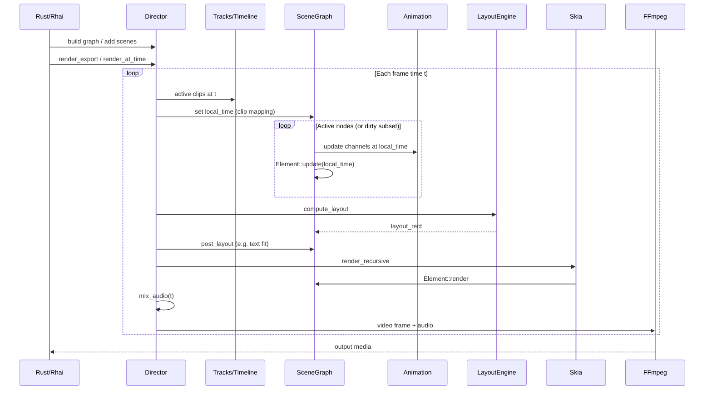

# Director Engine Architecture

High-level map of the runtime. **Normative spines** (time, identity, pipeline, etc.): [core-contracts.md](./core-contracts.md). **Hardening program:** [../plans/00-core-hardening-index.md](../plans/00-core-hardening-index.md).

## Crates

| Crate | Role |
|-------|------|
| `director-core` | Scene graph, timeline, layout, animation, Rhai API, export, visual tests |
| `director-cli` | CLI render entrypoints |
| `director-schema` | JSON / schema-facing types |
| `director-pipeline` | Schema → Director loading |
| `lottie-*` | Lottie parse / data / Skia path |

## High-level components

- **Director** — owns `SceneGraph`, tracks/timeline, assets, audio, compile/dirty state, export settings.
- **SceneGraph** — arena of `SceneNode` (`Element` + transform/layout/hierarchy/mask).
- **Track / TrackClip** — intended sequencing model (speed, source window, fades). Legacy `timeline: Vec<TimelineItem>` still exists and is used by several APIs/tests — **unification is plan 01**.
- **LayoutEngine** — Taffy flexbox/grid; writes `layout_rect`.
- **Renderer** — Skia recursive draw; optional dirty set + static subtree cache.
- **Animation** — `Animated<T>` keyframes, springs, easings (including bezier/hold/expression).
- **VideoWrapper / export** — FFmpeg encode path; color tags on H.264.
- **Scripting** — Rhai handles over `Arc<Mutex<Director>>`.

## Frame loop

## Data flow (summary)

1. **Author** — Rhai (or Rust) mutates the live `Director`.
2. **Update** — clip local time → animated properties → element state.
3. **Layout** — Taffy measures and places.
4. **Render** — Skia rasterizes (effects, masks, nested comps).
5. **Export** — frames + mixed audio to FFmpeg.

## Incremental path (in progress)

`compile()` builds a dependency graph; `invalidate` fills `dirty_nodes`; `render_at_time` may update/render a subset and consult `static_cache`. **Correctness requirement:** full render ≡ incremental (plan 03). Until that gate exists, treat incremental as optimization under test, not gospel.

## Nested compositions

`CompositionNode` embeds an inner `Director` and renders it to an offscreen surface. Identity and time across the boundary are defined in [core-contracts.md](./core-contracts.md) (plan 02).

## Related docs

| Doc | Purpose |
|-----|---------|
| [core-contracts.md](./core-contracts.md) | Normative spines + current gaps |
| [../plans/](../plans/00-core-hardening-index.md) | Hardening implementation plans |
| [../archive/](../archive/README.md) | Historical audit / deferred product plans |
| [../contributing/development.md](../contributing/development.md) | Build and test |
